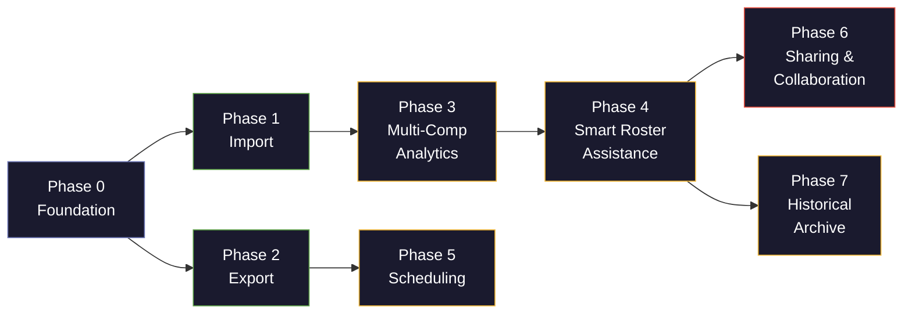

# 🗺️ Roster Dashboard — Development Roadmap

> Sequenced for **maximum velocity**: each phase unlocks capabilities the next phase depends on. Estimated complexity is relative to the current codebase size.

---

## Phase 0 — Foundation Refactors *(prerequisite for everything)*

These aren't user-visible features, but they unblock every phase that follows. The current architecture is close — the pluggable `data-service.js` loader pattern and the centralized `state-manager.js` are good bones — but a few structural upgrades will pay dividends.

| # | Item | Rationale | Complexity |
|---|------|-----------|:----------:|
| 0.1 | **Generalize the data model** — decouple from the hardcoded `2027-tryouts` shape; support an arbitrary list of "score sets" (tryouts, mock 1, mock 2, …) each with their own `eventScores` + `candidateProfiles` | Everything in Phases 1–4 assumes multiple data sources | 🟡 Medium |
| 0.2 | **Normalize candidate identity** — add a canonical `candidateId` keying strategy (name + grade + email hash) so records from different imports can be matched | Required for cross-competition views | 🟢 Low |
| 0.3 | **Extract render pipeline into a controller** — move the 150-line `render()` in `main.js` behind a thin `RenderController` so different views (schedule, export, multi-comp) can share model computation | Prevents code duplication in later phases | 🟡 Medium |
| 0.4 | ✨ **Undo/redo stack** — add a lightweight command history on top of `state-manager.js` with Ctrl+Z / Ctrl+Shift+Z support for selection changes | Selection mistakes during live drafting sessions are common and frustrating; cheap to add now, painful to retrofit later | 🟢 Low |

---

## Phase 1 — Dynamic Data Import *(make it not static)*

Replace the hardcoded JSON files with user-driven import, using the existing `registerLoader()` / `loadData()` abstraction.

| # | Item | Rationale | Complexity |
|---|------|-----------|:----------:|
| 1.1 | **CSV import via drag-and-drop or file picker** — parse with a lightweight library (e.g., PapaParse) into the generalized data model from 0.1 | Core user request; lowest friction format | 🟡 Medium |
| 1.2 | **XLSX import** — add SheetJS (xlsx) as a parser option, with a column-mapping UI so the user can tell the app which columns map to `id`, `name`, `event`, `raw`, etc. | Core user request; grading sheets are almost always Excel | 🟡 Medium |
| 1.3 | **Import wizard / column-mapping modal** — a step-by-step UI: pick file → preview first 5 rows → map columns → confirm | Without this, import silently breaks on unexpected column names | 🟡 Medium |
| 1.4 | **Multi-dataset management** — a sidebar or dropdown to switch between imported datasets (Tryouts, Mock 1, Mock 2, …) stored in IndexedDB | Enables the Phase 3 comparative views | 🟡 Medium |
| 1.5 | ✨ **Paste from Google Sheets** — intercept clipboard data and parse tab-separated values directly into the import pipeline | Many Scioly coaches copy-paste from shared Sheets rather than downloading; dramatically reduces friction | 🟢 Low |

---

## Phase 2 — Export & Output *(get data out in useful forms)*

| # | Item | Rationale | Complexity |
|---|------|-----------|:----------:|
| 2.1 | **Roster list export** — export the selected roster as CSV/XLSX with configurable sort order (rank, alphabetical, randomized) | Core user request | 🟢 Low |
| 2.2 | **Configurable export columns** — toggle which fields to include: name only, name + email, name + parent email, name + grade + events, etc. | Core user request; different audiences (parents, school admin, coaches) need different views | 🟢 Low |
| 2.3 | **Printable schedule tables** — generate and export (PDF via `window.print()` with a `@media print` stylesheet) event-by-person and person-by-event grid views | Core user request; coaches print these for competition day | 🟡 Medium |
| 2.4 | **Print-optimized competition-day cards** — one card per person listing their events, room numbers, and partner(s) | Natural extension of 2.3 | 🟢 Low |
| 2.5 | ✨ **Copy to clipboard as Markdown table** — one-click button to copy the current roster/scoreboard view as a formatted Markdown table | Coaches frequently paste roster info into Discord servers or Google Docs; outsized utility for minimal effort | 🟢 Low |

---

## Phase 3 — Multi-Competition Analytics *(tryouts + mocks, together and separate)*

Depends on Phase 0's generalized data model and Phase 1's multi-dataset management.

| # | Item | Rationale | Complexity |
|---|------|-----------|:----------:|
| 3.1 | **Per-competition isolated views** — each imported dataset gets its own full dashboard (scoreboard, KPIs, charts) | Core user request; need to see each competition in isolation | 🟡 Medium |
| 3.2 | **Combined / aggregate view** — merge all datasets, apply configurable weighting (e.g., tryouts 50%, mock 1 30%, mock 2 20%), recalculate composite PI | Core user request; the real draft decisions happen here | 🔴 High |
| 3.3 | **Trend visualizations** — per-candidate sparklines or line charts showing score trajectory across competitions | Natural extension; answers "are they improving or regressing?" | 🟡 Medium |
| 3.4 | **Comparative event heatmap** — events × competitions matrix colored by team strength | Surfaces which events are consistently weak across competitions | 🟡 Medium |
| 3.5 | ✨ **Head-to-head comparison mode** — select two candidates and see a side-by-side radar chart of their event profiles | Essential for close draft decisions between similarly-ranked candidates | 🟡 Medium |
| 3.6 | ✨ **Score change alerts** — automatically flag candidates whose scores changed dramatically between competitions (±15+ normalized points) | Surfaces both breakout improvements and concerning performance drops | 🟢 Low |

---

## Phase 4 — Intelligent Roster Assistance *(smart recommendations)*

Depends on Phases 0–3 for the data richness to make recommendations meaningful.

| # | Item | Rationale | Complexity |
|---|------|-----------|:----------:|
| 4.1 | **"Best player available" ranker** — enhance the existing gap-closing `renderRecommendations()` to also surface the single highest-impact pick considering all gaps simultaneously (a greedy set-cover heuristic) | Core user request; the current rec engine is per-gap, not holistic | 🟡 Medium |
| 4.2 | **"Best fit for Team 1/2" suggestions** — when running two teams (MI + MS or Team A + Team B), suggest optimal distribution of shared-eligible candidates | Core user request | 🔴 High |
| 4.3 | **Event conflict / cross-event prompt** — when a candidate is added to a team, surface a toast/popup listing their other strong events and prompting "Also add to [Event X]?" | Core user request; prevents overlooking a candidate's secondary strengths | 🟡 Medium |
| 4.4 | **Partner history tracking** — store and reference which candidates have been paired in past rosters, surface a warning/note when re-pairing or splitting established partners | Core user request; partnership continuity matters for build events | 🟡 Medium |
| 4.5 | ✨ **Draft simulation mode** — a "what-if" sandbox where you can tentatively assign candidates to events and see the projected team score update in real-time *without* committing to selections | Undo (0.4) helps with mistakes, but a full sandbox is better for exploratory experimentation | 🟡 Medium |
| 4.6 | ✨ **Fatigue / event-load balancer** — flag candidates assigned to too many events (e.g., >4) and surface a warning with redistribution suggestions | Prevents burnout and ensures realistic event loads; easy to overlook during manual drafting | 🟢 Low |
| 4.7 | ✨ **Auto-roster optimizer** — given constraints (max events per person, min coverage per event), compute an optimal or near-optimal assignment using constraint satisfaction | Killer feature; computationally complex but transformative for large rosters | 🔴 High |

---

## Phase 5 — Competition Scheduling *(block times and logistics)*

| # | Item | Rationale | Complexity |
|---|------|-----------|:----------:|
| 5.1 | **Competition config profiles** — define block/time slot structures for different invitationals (each has different schedules) | Core user request | 🟡 Medium |
| 5.2 | **Conflict detection engine** — given a schedule + roster assignments, flag every person who has two events in the same time block | Essential for schedule validity | 🟡 Medium |
| 5.3 | **Schedule visualization** — interactive Gantt-style or grid view of the competition day, color-coded by person or event | Makes conflicts and gaps visually obvious | 🔴 High |
| 5.4 | **Auto-schedule suggestions** — given events and time blocks, suggest conflict-free assignments | Stretch goal; significant algorithmic work | 🔴 High |
| 5.5 | ✨ **Volunteer/proctor assignment** — a lightweight parallel track in the scheduler for non-competitors (parent proctors, coaches for homeroom events) | Many teams need to schedule proctors alongside competitors; natural extension of the scheduling system | 🟡 Medium |

---

## Phase 6 — Sharing & Collaboration *(live and connected)*

This is intentionally last: it's the highest-complexity, highest-risk work, and every prior phase adds value as a standalone local tool.

| # | Item | Rationale | Complexity |
|---|------|-----------|:----------:|
| 6.1 | **Config export/import** — serialize the full app state (selections, datasets, settings) as a shareable `.json` config file | Core user request; simplest sharing mechanism | 🟢 Low |
| 6.2 | **Shareable URL state** — extend the existing `serializeState()` to encode full config into a URL (or a shortened link via a service) | Core user request; `state-manager.js` already has the skeleton for this | 🟢 Low |
| 6.3 | **Cloud persistence** — store data in a backend (Firebase Realtime DB, Supabase, or similar) keyed by team/season | Prerequisite for real-time collab | 🔴 High |
| 6.4 | **Real-time collaborative editing** — multiple coaches can view and edit the same roster simultaneously with live cursors/selections (CRDT or OT via e.g., Yjs + WebSocket) | Core user request; most architecturally complex feature | 🔴🔴 Very High |
| 6.5 | **Role-based permissions** — head coach can edit, assistant coaches can suggest, parents can view | Natural requirement once multi-user is enabled | 🟡 Medium |
| 6.6 | ✨ **Change log / audit trail** — automatically log who changed what and when, with a reviewable timeline view | Essential for accountability once multi-user is live; answers "who dropped candidate X?" | 🟡 Medium |
| 6.7 | ✨ **Comment threads on candidates** — let collaborators leave notes ("strong in lab but nervous at competition") attached to specific candidates, visible to all editors | Captures qualitative context that scores alone can't represent; invaluable during collaborative drafting | 🟡 Medium |

---

## Phase 7 — Historical Archive *(reference past seasons)*

| # | Item | Rationale | Complexity |
|---|------|-----------|:----------:|
| 7.1 | **Season archive** — save completed rosters to a historical store (local or cloud) tagged by year/season | Core user request (reference back to previous rosters) | 🟡 Medium |
| 7.2 | **Cross-season lookup** — when viewing a candidate, surface their participation and performance in previous seasons | Answers "have they done this event before?" | 🟡 Medium |
| 7.3 | **Partnership history graph** — visualize who has been paired with whom across seasons | Core user request; informed pair decisions | 🟡 Medium |

---

## Summary: Recommended Execution Order

> [!IMPORTANT]
> **Phases 0–2 are the critical path.** They transform the dashboard from a static analysis tool into a dynamic, reusable workflow tool. Every phase after that is additive value — the app is already *useful* after Phase 2.

> [!NOTE]
> **Parallelism opportunity:** Phases 1 (Import) and 2 (Export) are independent of each other and can be developed concurrently. Phase 5 (Scheduling) is also mostly independent and can be pulled forward if competition day is approaching.
